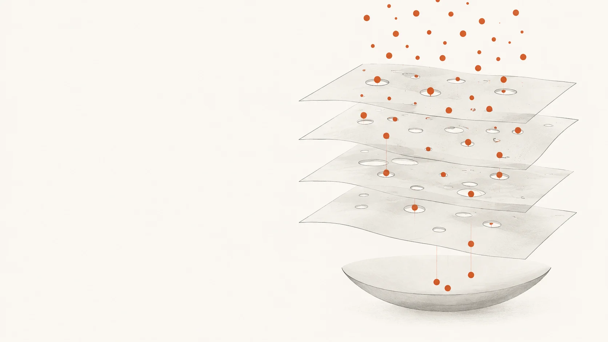
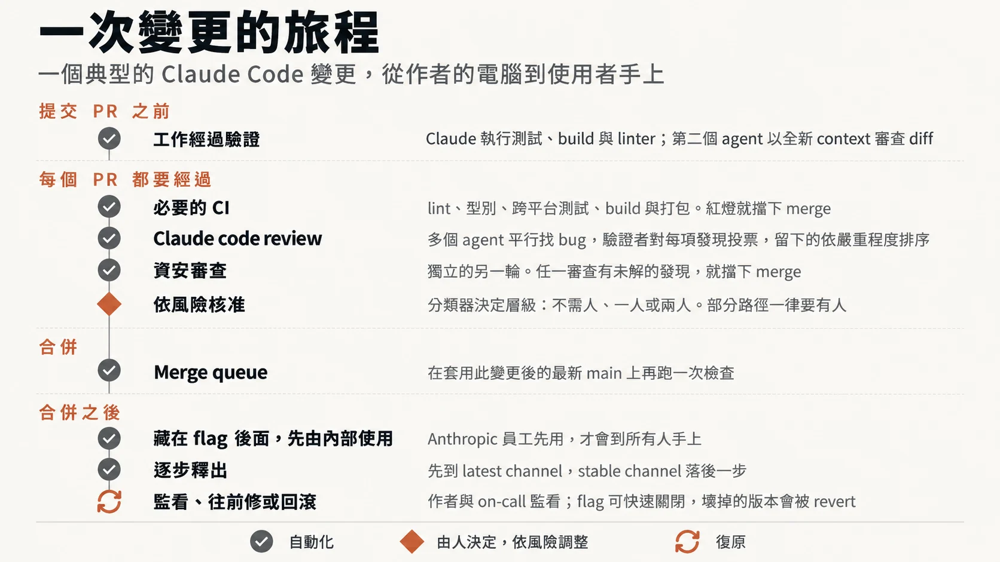
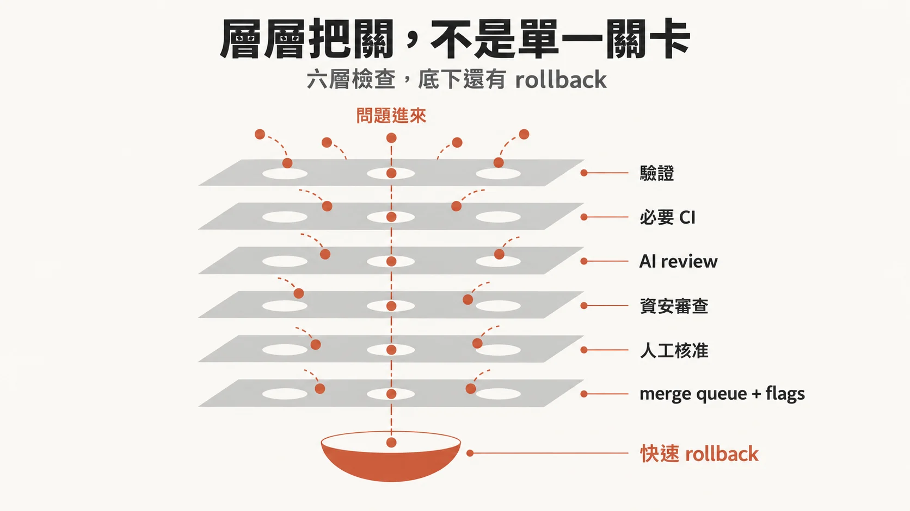
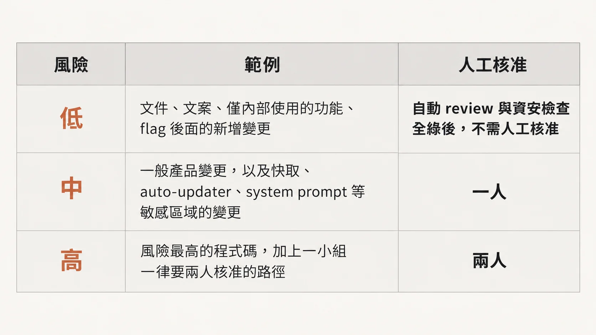
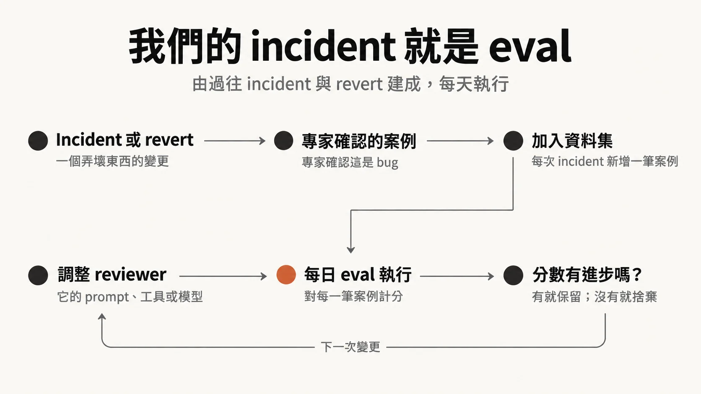
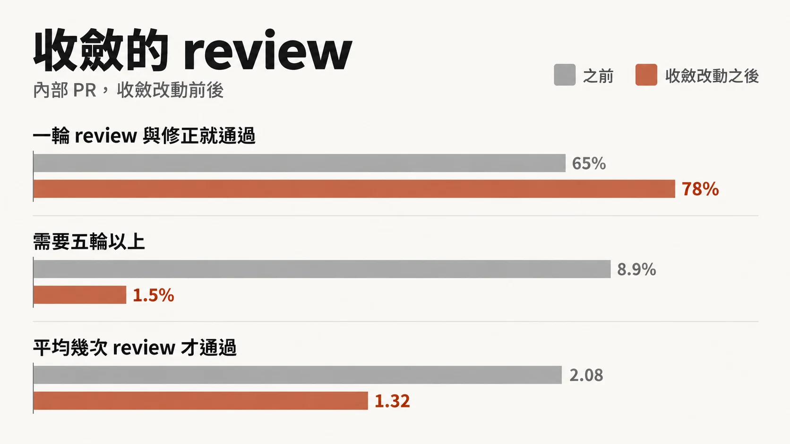
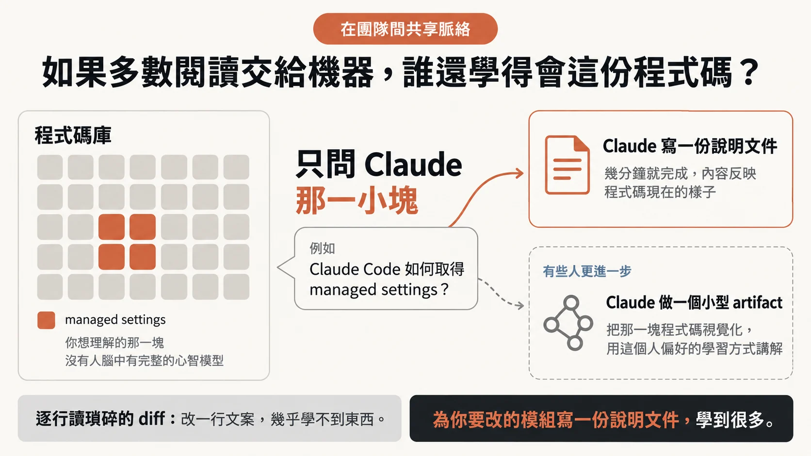

> 本導讀的分析與撰稿由 AI 模型完成，不是人類分析，也沒有經過人工逐句校稿。

*圖說：AI 生成的概念插畫，比喻每層各攔一部分、最後還有回收機制的審查制度。*

## 九成程式碼由 Claude 寫，誰來讀？

Anthropic 自述，Claude 寫了 Claude Code 約 90% 的程式碼。這麼多程式碼，誰來讀？讀不完、出了事，又怎麼辦？

文章給的成績是：6 月到 9 月之間，**合併進 Claude Code 程式碼庫的 PR 超過兩倍，需要 revert 的 PR 比例卻下降超過 40%**（[官方部落格](https://claude.dev/blog/solving-code-review-at-anthropic)）。這是 Anthropic 自述，只能看出方向，但書見文末數字表。

變更量的背景來自整個 Anthropic monorepo：今年 5 月每天大約有 2,500 個變更被合併，到了 9 月超過 30,000，四個月超過十二倍（[官方部落格](https://claude.dev/blog/solving-code-review-at-anthropic)、[Redesigning source control](https://www.anthropic.com/engineering/redesigning-source-control)）。要分清楚的是，這是 monorepo 的數字。原文寫明，Claude Code 不在那個 monorepo 裡，它有自己的幾個 repo（CLI、桌面與網頁 app、行動 app）；Claude Code 這邊沒有公布每日合併數，但同樣承受大量變更。

code review 並沒有停，只是**大部分「閱讀」交給了自動化**，整套流程改以替人省時間為目標，同時花大力氣讓錯誤能又快又容易地退回（rollback）。

## 一行一行讀，為什麼走不下去

傳統 code review 有個隱含假設：有人讀過，所以比較安全。原文只說，變更量暴增之後，逐行人工審查越來越難，甚至不可能。本文判斷，實務上通常會走向兩種情形：審查者變成瓶頸，PR 排隊等人；或是開始草草按下核准，讓「有人讀過」淪為形式。

Anthropic 先換掉問題本身。

> 重點：「有沒有人讀過」只是不精確的替代指標；該問的是，這個變更可能出什麼錯，哪一種檢查（自動的或人工的）最適合把它抓出來。

問題一換，審查的時間點也跟著動。傳統審查發生在事後，程式寫完、PR 開好、作者等別人有空。Claude Code 團隊把審查拉進寫程式的過程，像邊打字邊跑的拼字檢查。**多數變更在人被請來看之前，至少已被 Claude 審過、修過一輪。**

文章還換了一種算帳的方式：**人的時間是「兩面的成本」**。一面是花在審查上的時間，另一面是修補爛程式碼引入的 bug 所花的時間。只壓低前者、沒壓低後者，人力並沒有省下來，只是從審查搬到救火。

目標寫得很具體：Claude Code 的 repo 裡，**大多數 PR 合併時最多只需一個人在迴圈裡（可以就是作者），而且 revert 與事故不能增加**。追蹤的指標有每個 PR 人工核准次數的中位數（以及第 95 百分位）、人工留言數、PR 等人的時間；revert 率與事故率當護欄。

> 重點：revert 率與事故率一旦上升，代表人的時間沒有省下，只是換了地方花。

## 一個變更從筆電到使用者手上的路

一個典型的 Claude Code 變更，不論來自工程師的筆電，還是 Slack 裡的 Claude session，都走同一條路。

*圖說：一次變更的旅程，大部分步驟自動化，只有依風險決定的核准由人判斷。（譯自原文圖 A，繁中版由 AI 重繪）*

原文把這條路整理成六層檢查：第 1 到第 6 層負責攔截，第 7 項是快速回饋與退回，接住穿過所有層的漏網之魚。

本文判斷，這很像資安領域的縱深防禦：沒有一層被期待完美，**靠的是各層盲點不重疊**。下方圖 B 中央那條直通到底的虛線就是這個弱點：如果某一類問題剛好落在每一層的盲點上，它會一路穿到最底下的退回機制。

*圖說：每一層都有破洞，但洞的位置各不相同；最底下的退回機制接住極少數一路穿透的問題。（譯自原文圖 B，繁中版由 AI 重繪）*

### 第 1 層：PR 開出來之前

大部分審查發生在 PR 之前。他們要求 Claude 做能跑的事，例如跑測試、跑 build、把截圖和設計稿比對，並拿出結果，別只說「完成了」；**再讓一個 subagent 用全新的 context 審 diff**。這兩招都寫在官方的[最佳實務指南](https://code.claude.com/docs/en/best-practices)裡。打造 Claude Code 的 Boris Cherny 個人估計，給 Claude 一套驗證流程，產出品質可以提高兩到三倍。

**自動審查者若一再抓到同一類問題，就從源頭修**：改 skill、加 lint 規則，或更新文件。CLAUDE.md 描述專案的慣例與目標，每次審查都會載入，大型程式碼庫要寫短。

REVIEW.md 讓程式碼負責人告訴審查者自己那塊什麼最重要，他們也會另外檢查審查者是否真的照做。好的 REVIEW.md 要：

- 定義什麼算失敗
- 限制吹毛求疵
- 要求附上檔名與行號
- 在開頭給出問題數量，或明說「沒有問題」

### 第 2–4 層：人看之前，先跑過幾十項檢查

每個 PR 在人看之前，先經過 Claude 審查（第 2 層）：把 diff 放在整個程式碼庫與作者陳述的意圖之下檢視，看它是否真的解決問題、跟大系統合不合、會不會弄壞別處。找到的問題會先過濾：**多個 agent 平行找 bug，再投票決定真假**，票數不夠的丟掉；純風格類意見也濾掉，這些過濾規則先在自家 PR 上做過 A/B 測試。

剩下的依嚴重度標成 Important、Nit 或 Pre-existing，最後一類讓作者不必替不是這個 PR 引入的舊 bug 挨罰。

在 Claude Code 團隊內部，資安審查是另一個獨立步驟（第 3 層），兩種審查只要還有未解的 finding，PR 就不能合併；作者可以修掉，或附理由關閉 thread（處理誤報的方式）。

第 4 層是必要的自動檢查：lint、型別、各平台測試、build，一個典型 CLI PR 在任何人看之前就可能跑過幾十項檢查。PR 範本裡有「怎麼測的」「怎麼 revert」，Claude 可以代答，作者負責確認。圖 A、B 把必要 CI 排在 AI 審查之前，與正文編號不同。

這裡要把兩件事分開。「有未解 finding 就不能合併」是 Claude Code 團隊自己的流程規則。對外的 Code Review 產品依[產品文件](https://code.claude.com/docs/en/code-review)，**只發布 findings，不核准也不擋 PR**；它只讀 diff 與周邊程式碼，不執行程式；文件也直說它可能漏掉 bug。原文沒說內部怎麼實作這個「擋」，只在導入清單裡建議「規定所有 review thread 解決才能合併」。

這個產品開放給 Team 與 Enterprise 方案，管理員可替每個 repo 設定 Quick、Standard、Deep 三種審查等級；另有本機輕量版 `/code-review`。Anthropic 自述，自 research preview 推出以來，內部 PR 得到實質審查意見的比例從 16% 升到 54%（[官方部落格](https://claude.dev/blog/solving-code-review-at-anthropic)）。

### 第 5 層：依風險決定要幾個人

*圖說：核准人數依變更內容的風險而定，從零人到兩人。（譯自原文圖 C，繁中版由 AI 重繪）*

**分級依據變更本身，和作者是誰無關。**一個分類器判定風險等級，另一個分類器判斷某個變更是否即使等級沒要求、也該多一個人核准；負責人標為敏感的路徑與任何 CI workflow 檔案，永遠需要額外核准。

值得細看的是中風險：快取、自動更新器、系統提示詞這些敏感區域只要一個人。敏感不等於最高風險；要兩個人的，是最高風險的程式碼，加上一小群固定要兩人核准的路徑。本文判斷，對想參考的團隊來說最難抄的是那兩個分類器，整套分級可不可信全繫於它們，而原文沒交代分類器怎麼建、誤判率多少。

幾條規則讓分級不容易被鑽漏洞：

- 只有 repo 信任名單上的作者享有較寬鬆要求，其他人一律要第二人核准。
- **agent 的核准不算人工核准**，需要人的時候它無法頂替。
- agent 寫的 PR，啟動它的人永遠算在必要審查者之內。
- 核准只對一個 commit 有效，出現 agent 推的或手動解衝突的新 commit，就得重新核准。

### 第 6 層與第 7 項：合併、釋出、退回

merge queue 讓每個變更在套用後的最新 main 上重跑所有檢查，避免兩個各自通過的 PR 合在一起弄壞 main。新功能多半藏在 feature flag 後，先給 Anthropic 員工用，對外則先放 latest 頻道，stable 頻道隨後跟上。

merge queue 是 Claude Code repos 的做法；Anthropic 另一篇工程文章談的是 monorepo，那裡的說法是在 agent 規模的 monorepo 上，傳統 merge queue 已經不合理（[Redesigning source control](https://www.anthropic.com/engineering/redesigning-source-control)）。兩篇講的是不同規模、不同程式碼庫，別混著讀。

第 7 項承認總會有壞變更溜過去。**藏在旗標後的變更不必重新部署就能關掉**；每週輪值的 on-call 在事故檢討時會回頭問「哪一層本該攔住它」。文中坦承，目前還沒有依 revert 與事故指標自動調整核准要求的斷路器，仍在研究。

## 審查者也要被審

AI 審查者換模型或改提示詞後，好壞得有人知道，所以審查者本身也要持續校準。

*圖說：每次事故都會變成評估集的一筆案例，審查系統的每次調整都要對整個集合重跑。（譯自原文圖 D，繁中版由 AI 重繪）*

本文判斷：評估集來自自家真實的失敗，比外部 benchmark 貼近現場。限制也很明顯：它只衡量過去出過的那類錯，對沒發生過的新型失敗沒有鑑別力，而且每筆案例都要熟悉程式碼的工程師確認，耗的是資深人力。

另一端是雜訊。只要願意回報一堆不是 bug 的東西，**抓 bug 率很容易就能拉高**。他們依 PR 上的人怎麼處理每則留言來分類（修了、拒絕、說明是刻意的、認為無所謂），也把審查系統跑在已知乾淨的 PR 上，看它多常報出會導致有害修改的意見。

明訂的優先序是：先找到真 bug，再減少審查輪數。後者在 agent 當作者時特別要緊。

> 重點：人看到一則吹毛求疵的意見，一秒就略過；agent 收到同一則，會再推一個 commit，觸發再一輪審查。

文中的極端例子是 CLI 專案裡一個 PR，在 agent 作者與 agent 審查者之間一夜來回超過五十輪，最後靠人手動停下。對反覆被標出的內容跑 git blame，**約 59% 的程式碼從第一輪就在了**：審查系統很少找到新 bug，只是每輪多挖出幾個舊的。這是 Anthropic 自述的單一案例；本文認為它的機制有普遍性：兩個不會累的 agent 湊在一起，沒有收斂條件就會互相拖著跑。團隊自己預設跑好幾輪的習慣也火上加油。

他們的修法有四條：

- **三輪後要求作者重新評估做法**
- 初始幾輪後只重審新 diff
- 指出 bug 的類別，讓作者一次修完同類問題
- 不重複回報已提過的問題

*圖說：內部 PR 在收斂改動前後的審查輪數變化。（譯自原文圖 E，繁中版由 AI 重繪）*

這組數字同樣是 Anthropic 自述（見文末數字表）。最值得看的是長尾：需要五輪以上的 PR 從 8.9% 降到 1.5%。

## 人被留在哪裡

讓資深工程師停下手邊工作去審一個常見錯誤，比自動化昂貴。文中列出幾件仍需要人的事：

- 決定該不該做，設定產品的品味與目標
- 審查計費、自動更新器、CI workflow 這類危險程式碼
- 架構審查，因為那會變成別人跟隨的慣例
- 核對測試輸出、指令、截圖等證據
- 承擔責任：不管誰打的字，每個上線的變更都有一個人負責

> 重點：如果你說不出這些檢查會漏掉什麼，就別只要一個讚，你需要真正的審查。

code review 向來還有第二個功能：讓團隊知道程式碼改了什麼。讀同事的 diff，是多數人理解程式碼庫的方式。機器接走大部分閱讀之後，原文自問：**那要怎麼學會這個程式碼庫？**

*圖說：想了解哪一塊，就請 Claude 針對那一塊說明。（譯自原文圖 F，繁中版由 AI 重繪）*

Anthropic 坦白說他們沒有正式機制處理這件事，也不認為誰需要腦中裝著整個 Claude Code。補位的是隨需產生的說明，加上預設公開、在開放 Slack 頻道工作的文化。

本文判斷，這個做法的說服力來自比較基準：逐行讀一行文案修改本來就學不到多少東西。它沒回答的是，被動接觸程式碼的機會變少後，新人怎麼知道該問哪一塊？要主動問，得先知道自己哪裡不懂。想導入的團隊得自己補上這個落差。

責任歸屬是**「你合進去的，你負責」**，中小型變更出事，一般預期作者自己修。原文說這不會失控，靠的是變更小、凡事可退回、影響範圍決定審查門檻、遙測與內部使用很快暴露退化，以及不究責、事故檢討看系統。

最後是轉向：agent 讓開工變得便宜，但頻道裡有人指出方向不對時，作者就關掉 PR 或改做法。程式碼寫得快，關掉也不心疼，關鍵是在討論串早期轉向，別等 PR 完成才丟一個擋下來的意見。

## 這些數字該怎麼讀

本文數字幾乎都是 Anthropic 對自家流程的描述，沒有第三方能交叉驗證。

| 數字 | 內容 | 讀的時候要留意什麼 |
|---|---|---|
| 約 90% | Claude 寫了 Claude Code 約 90% 的程式碼 | 官方自述，未說明怎麼計算 |
| 2,500 → 30,000 以上 | monorepo 每日合併的變更數，5 月到 9 月 | 兩篇官方文章一致，是本文少數能由兩個官方頁面對上的數據；這是 monorepo，Claude Code 不在其中 |
| PR 超過兩倍、revert 降逾 40% | Claude Code 程式碼庫 6 月到 9 月的合併 PR 數與需 revert 的比例 | 官方自述，沒有 PR 實際數量（分母）、沒有 revert 的定義、沒有樣本說明 |
| 16% → 54% | research preview 推出以來，內部 PR 得到實質審查意見的比例 | 官方自述；對象是內部 PR |
| 2 到 3 倍 | 加上驗證流程後 Claude 產出品質的提升 | Boris Cherny 的個人估計，未附量測方式 |
| 50 輪以上、約 59% | 單一 PR 一夜來回的輪數；反覆被標出的程式碼從第一輪就存在的比例 | 官方自述，單一案例 |
| 65%→78%、8.9%→1.5%、2.08→1.32 | 收斂改動前後的一輪通過率、五輪以上比例、平均通過輪數 | 官方自述，只出現在圖與官方表格，正文未寫；沒交代前後的觀察期間與 PR 數量 |

本文判斷，PR 翻倍、revert 比例下降兩者並陳，最容易被高估。沒有分母與 revert 定義，就無法判斷比例下降有多少來自品質提升、多少來自變更組成改變。照 Anthropic 自己的算法，方向是對的；能說的也就這樣。

## 這套制度真正在押注什麼

這一節是本文判斷，原文沒有這樣歸納；引用原文處會註明。

**這套制度的賭注壓在「退回」上**。低風險變更零人核准之所以說得通，是因為多數錯誤能在幾分鐘內被旗標、revert 或分階段釋出逆轉。這也指出它最可能壞在哪：有些錯誤退不回去。原文把計費、自動更新器、CI workflow 列為必須由人審的危險程式碼，正好對應退回成本高的地方；換到別的團隊，這份清單得依自己的系統重列。

第二個賭注是護欄指標。前面提過，目前沒有斷路器，revert 率與事故率變差時，仍靠人眼盯著。

第三個是信任名單與分類器。名單開太寬，自己人就等於免審；分類器只要看走眼，高風險的變更會被當成低風險放過去。

原文也記下一個團隊成員的觀察：放慢速度、減少產出確實可能提高準確度，但主要是因為工作量變少。Anthropic 選擇把力氣放在更快發現與修正問題上。對 Claude Code 這種高頻迭代、修正能很快發布的產品，這個選擇合理；對一年只發布幾次、每次要客戶配合升級的軟體，就不一定成立。

原文最後談方向：產品版 Code Review 推出時，設計是最終核准仍由人做；在自家 repo，負責人已在決定哪些低風險變更可以在自動檢查通過後直接合併，這條界線還會移動。目標是在 revert 率不高於現在的前提下，持續減少每個變更需要的人力。

## 想照做，先做哪幾件

原文的導入清單依流程階段排列（PR 之前、每個 PR、核准、合併後），大部分元件已能直接取得。下面改依團隊規模與成本重排，排序和小團隊建議是本文判斷：

1. 從 PR 之前開始，任何規模都能做。給 agent 一份可執行的檢查清單寫進簡短的 CLAUDE.md，用 hooks 自動呼叫 formatter 與 linter，開 PR 前在本機跑 `/code-review`、`/security-review`，或讓新 context 的 subagent 審 diff。成本最低，小團隊第一週就能上。
2. AI 審查者先在一個 repo 試幾週。原文建議在單一 repo 加上審查者並調整 REVIEW.md，再推到其他 repo。沒調好的審查者會製造大量雜訊，人很快就學會忽略它。
3. PR 範本加上「測試方式」「風險」「如何退回」，並規定所有審查 thread 解決才能合併。用 Code Review 產品的話要記得它本身不擋 PR，這條規則得靠 branch protection 或 CI 自己設。
4. 一開始就限制審查輪數，幾輪後只審新 diff。只要讓 agent 回應審查意見就該設上限，與團隊大小無關。
5. 風險分級從嚴開始，看到證據再放寬。依變更定等級，bot 核准不能抵必要核准，新 commit 推上來就撤銷舊核准，auth、計費、CI、釋出流程與安裝程式用 CODEOWNERS 與 branch protection 指定由人核准。小團隊可以先只做「agent 核准不算數」與「敏感路徑必須有人」兩條，分類器等量大到人工判斷忙不過來再說。
6. 先把退回做便宜，再談放寬核准。merge queue、feature flag、內部先用、分階段釋出、一步完成的 revert 機制是地基。**沒有快速退回機制的團隊，不該照抄零人核准的低風險層級**，省下的審查時間很可能轉去救火。
7. 把事故與 revert 記下來，變成審查者的評估集，每次換提示詞、工具或模型就重新評分，並以 revert 與事故率當人力指標的護欄。逐筆確認案例要專家時間，適合已有一定事故紀錄的團隊；小團隊可以先從每次 revert 寫一行原因開始累積。

## 製作說明：這篇導讀由 AI 模型完成

本篇導讀由 AI 模型完成，整體未經人工逐句校稿，可能有誤，請以原文為準。文中數字多為 Anthropic 對自家流程的自述，已與官方頁面互相比對，只有單一來源或屬於個人估計者在文中降級標示；標「本文判斷」處是導讀的推論，原文沒有這樣說。

- 分析與撰稿：Claude Opus
- 統籌：Claude Sonnet 5.5
- 獨立審稿：Claude Opus，事實與編輯各一輪
- 最後潤稿與標重點：Claude Opus
- 圖片：原文圖 A–F 由 OpenAI Codex 的 imagegen 依原圖重繪為繁中版；原圖由 Anthropic 製作，版權屬原作者。封面為 AI 生成的概念插畫

## 來源清單

- [How the Claude Code team does code review](https://x.com/addyosmani/status/2114604912520921136)，2026-10-26，Addy Osmani 的 X 長文，文末註明為官方文章的改寫版，本導讀的主要素材
- [How the Claude Code team does code review](https://claude.dev/blog/solving-code-review-at-anthropic)，2026-10-15，Anthropic 官方部落格原文（與 X 長文同名，X 版為其改寫），作者 Addy Osmani、Morgan Westlee Lunt、Qing Wang
- [Code Review（Claude Code 產品文件）](https://code.claude.com/docs/en/code-review)，頁面未標日期（2026-10-29 查閱），說明產品只發 findings、不核准也不擋 PR、不執行程式碼、可能漏掉 bug
- [Redesigning source control at Anthropic](https://www.anthropic.com/engineering/redesigning-source-control)，2026-10-13（10-15 更新），Anthropic 工程文章，含 monorepo 每日合併數與 agent 規模 monorepo 上傳統 merge queue 不合理的說法
- [Claude Code best practices](https://code.claude.com/docs/en/best-practices)，頁面未標日期（2026-10-29 查閱），PR 前驗證與新 context subagent 審查的做法出處
